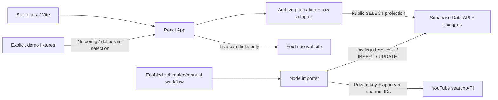

# Architecture and source reference

## 1. Runtime boundaries

Two independent runtimes use an externally managed Supabase database:

1. React/Vite browser application: public metadata reads, validation, tag/format/text filtering, external playback links.
2. Node importer: owner-approved YouTube search, bounded refresh/insert, privileged database access.

There is no checked-in server, authentication flow, Edge Function, database migration, or Supabase local-stack configuration.



The frontend adapter supports the importer's legacy `url`/`thumbnail` contract without assuming live compatibility triggers. Database uniqueness/security and source identity verification remain external owner requirements.

## 2. Technology/tooling

| Technology | Pinned version | Role |
| --- | --- | --- |
| React / React DOM | 19.3.0 | UI/root rendering. |
| TypeScript | 7.0.2 | Type-checking. |
| Vite | 8.3.2 | Development/build. |
| React Vite plugin | 6.1.1 | React integration. |
| Tailwind / Tailwind Vite plugin | 4.3.3 | Utility CSS. |
| Supabase JS | 2.117.2 | External Data API client. |
| Lucide React | 0.546.0 | Icons. |
| tsx | 4.23.15 | Existing TypeScript loader for Node tests. |
| Bun | 1.4.2 | Pinned lockfile installer. |
| Node | 22.12+ | Importer/tests; native fetch/AbortSignal. |

Unused Express, Gemini, dotenv, motion, autoprefixer, direct esbuild, and Express types were removed. tsx retains its own compatible transitive build dependency. There is no AI feature despite historical template metadata.

## 3. File inventory

```text
README.md                            Product/documentation entry point
docs/                                Current reference, review, remediation, provenance
.env.example                         Public variables and row format
.github/workflows/quality.yml         Frozen install, tests, type-gated build
.github/workflows/auto-update.yml     Disabled-until-approved scheduled importer
package.json / bun.lock              Pinned scripts/dependencies/tooling
index.html / metadata.json           Active tagged-video product metadata
vite.config.ts / tsconfig.json       Build, public env, aliases, type settings
scripts/fetch-youtube.cjs             Configuration, inference, bounded importer/CLI
tests/*.test.ts[x]                    Mapper/archive/importer/component regressions
src/main.tsx                         createRoot bootstrap
src/App.tsx                          Data state, request lifecycle, filters, active page
src/types.ts                         Canonical member/video types
src/lib/supabase.ts                   Optional client initialization/config diagnostics
src/lib/videoData.ts                  Validated pure row adapter and YouTube ID parsing
src/lib/archive.ts                    Explicit public projection and paginated reads
src/data/h2hData.ts                   Eight member entries and sixteen demo fixtures
src/index.css                        Fonts, focus-visible defaults, image helper
src/assets/images/*.jpg              Preserved original images
src/assets/images/*.webp             Smaller derivatives used by build
src/components/MemberSelector.tsx     Active controlled member controls
src/components/VideoCard.tsx          Active live link/demo article + local image failure
src/components/Footer.tsx             Active footer/scroll-to-top
src/components/Navbar.tsx             Dormant multi-tab navigation
src/components/HeroSection.tsx        Dormant promotional layout
src/components/MemberProfiles.tsx     Dormant profiles
src/components/PairingRecommendations.tsx  Dormant recommendations
src/components/VideoModal.tsx         Dormant embedded playback
```

## 4. Active component/interface boundaries

```text
main → App
       ├── Inline header and data-source status
       ├── Always-visible source/error/demo message and reload controls
       ├── MemberSelector → MemberAvatarItem × 8
       ├── Five inline presets
       ├── Format controls + labeled keyword search
       ├── Loading / no selection / results / empty results
       │   └── VideoCard × matching records
       └── Footer
```

| Interface | Responsibility |
| --- | --- |
| `mapSupabaseRowToVideoItem(value: unknown)` | Validate/normalize external legacy or canonical rows into `VideoItem`. |
| `getYoutubeId(value)` | Recognize exact valid ID/approved YouTube URL forms. |
| `fetchArchiveVideos(client, signal?, rowFormat?)` | Fetch complete publicly readable ranges with explicit projections; reject partial/error results. |
| `MemberSelector({ members, selectedMembers, onToggleMember, onClearAll })` | Controlled toggles, count, chips, clear actions; exposes toggle state. |
| `VideoCard({ video, selectedMembers })` | Live link or non-playable demo article; highlights tags; bounded image-error state. |
| `detectMembers(text)` | Conservative text inference only. |
| `loadConfig(env?, args?)` | Fail-closed importer settings/allowlist/window/budget validation. |
| `syncVideos({ client, fetchImpl?, ...config })` | Observable ingestion boundary; returns structured outcome. |

The root is not wrapped in a router, StrictMode, query client, or error boundary. There is one active page, no URL-backed filters, and no saved state.

## 5. Application state

| State | Initial / purpose |
| --- | --- |
| `videos` | Empty loaded dataset. |
| `isLoading` | Initially true; fetch/demo lifecycle. |
| `fetchError` | Visible generic load diagnostics, not raw provider secrets. |
| `dataSource` | `live`, `demo`, `empty`, or `error`. |
| `selectedMembers` | Empty; controlled canonical names. |
| `formatFilter` | `all`. |
| `searchQuery` | Empty. |
| Request ref | AbortController for cancellation/stale fetch protection. |
| Card image state | Failed URL; renders local placeholder until image URL changes. |

Clearing members and replacing them with a preset retain format/query. Member-only counts are calculated before keyword filtering. Results require every selected tag, then apply format and trimmed case-insensitive title/channel/description matching. No members means no results.

Filtering is linear over the loaded in-memory archive, with at most eight selected members. Paging fixes server-response truncation, not arbitrary-scale client memory/search behavior.

## 6. Fetch sequence

```mermaid
sequenceDiagram
  participant User
  participant App
  participant Reader
  participant DB as Supabase
  User->>App: Load / reload
  App->>App: Abort previous request; set loading
  alt No public configuration
    App->>App: Labeled sorted demo; no playback links
  else Invalid config / failed read / invalid row
    App->>App: Empty results + visible error, no automatic samples
  else Configured
    loop Until visible count/end
      App->>Reader: Fetch explicit projection with AbortSignal
      Reader->>DB: Ordered range, exact count
      DB-->>Reader: Actual returned rows
      Reader->>Reader: Validate; advance by actual length
    end
    Reader-->>App: Full valid visible dataset
    App->>App: Set live or empty source
  end
  User->>App: Select tags / format / query
  App->>App: Derive results locally
```

A 30-second signal bounds a full archive read. Previous/unmounted requests abort and cannot overwrite newer state. An initial PostgreSQL `42703` naming only the missing optional `description` column permits one ordered retry without that column; subsequent pages retain the reduced explicit projection. Other failures and mid-read schema changes reject the archive. There is no unordered fallback query, Realtime subscription, polling, or automatic sync-freshness clock.

Offset reads are deterministic by date/ID but not a transactional snapshot during concurrent changes. Data API errors are surfaced, not disguised as demo.

## 7. Importer behavior

The CLI is guarded by `require.main`, so test imports have no execution side effects. It uses exact approved channel IDs, validates snippet identity/metadata, infers conservative tags, uses stable video URLs, refreshes source fields while preserving editorial tags, and aggregates failures.

HTTP calls have timeout/bounded retry; actual attempts consume a global request budget. Recent/backfill modes expose completeness and continuation tokens. There is no exhaustive search-history guarantee or persistent automatic checkpoint. A database constraint remains mandatory for race-safe identity.

## 8. Dormant components

These are retained deliberately, not exposed as implemented features:

| Component | Retained interface / caveat |
| --- | --- |
| Navbar | Tab callbacks and reset count; no active App tab state. |
| HeroSection | Scroll/explore callbacks and promotional text; historical AND/OR claims must be reviewed before activation. |
| MemberProfiles | Profile grid and select/scroll callback; unsourced facts require owner review. |
| PairingRecommendations | Six pairings and optional mode callback; active page has five inline presets instead. |
| VideoModal | Nocookie embeds and Escape/backdrop close; no active modal state, and focus-management review is required before activation. |

They remain in type-check scope. Dormant clickable divs/modal semantics were not declared fully accessible solely because active controls were improved.

## 9. Styling/assets/configuration

- `zh-Hant` document, Plus Jakarta Sans/Noto Sans TC via Google Fonts.
- Tailwind utilities, `.image-hd`, and global focus-visible styling.
- External Imgur avatars; source images from allowed HTTP(S) URLs; local visual failure placeholders.
- Four WebP derivatives total ~0.320 MB versus ~3.33 MB original JPEGs. Originals remain in source but are not bundled.
- `@/` aliases point to repository root, not `src/`, in both TypeScript and Vite.
- Environment values are embedded at build time; public prefixes never protect secrets.
- Existing `DISABLE_HMR` behavior is preserved.
- Native-compatible `import.meta.url` alias resolution replaces `__dirname`.
- Type configuration uses ES2022/ESNext, bundler resolution, automatic JSX, `noEmit`, and `skipLibCheck`.
- Build runs the type check first; quality CI also runs regressions.

See [Testing](DEVELOPMENT_TESTING.md), [Data model](DATA_MODEL.md), and [Operations](DEPLOYMENT_OPERATIONS.md) for validation and external requirements.
