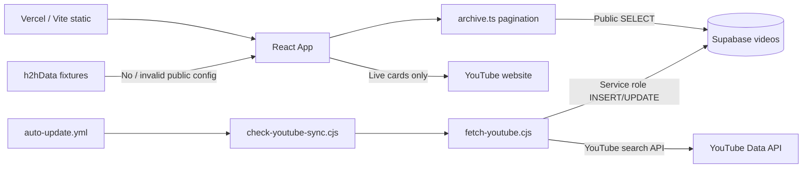

# Current-state analysis — Hearts2Hearts Video Archive

**Review date:** 2026-10-19  
**Workspace:** `C:\Users\Jack\Documents\GitHub\Test1`  
**Product (UI / metadata):** Hearts2Hearts (H2H) 粉絲精選影片庫  
**Package name:** `react-example` (stale template name; not product branding)

This document is a whole-repository review of the working tree as inspected on 2026-10-19. It consolidates architecture, data flow, documentation inventory, remediation status, and open risks. Historical baselines remain authoritative for their recorded commits:

| Document | Role |
| --- | --- |
| [COMPREHENSIVE_REVIEW.md](COMPREHENSIVE_REVIEW.md) | 51-finding pre-repair baseline at `2b61799` |
| [REPAIR_VALIDATION.md](REPAIR_VALIDATION.md) | Post-repair local build/test evidence |
| [REMEDIATION.md](REMEDIATION.md) | R1–R15 issue lineage and owner blockers |
| This file | Fresh structural analysis of the present tree |

**Verification note:** Node/npm/Bun were not available in the review shell PATH. Runtime claims below are **code-confirmed** against sources and existing docs, not re-executed here. CI contracts still specify Bun 1.4.2 + Node 22.

---

## 1. Executive summary

Hearts2Hearts is an unofficial **Traditional Chinese** fan video archive for K-pop group Hearts2Hearts. Users filter by member tags, five content genres, keyword search, and sort order. The browser is a static Vite/React SPA that reads public Supabase rows. A separate Node importer, gated by GitHub repository variables, searches owner-approved YouTube channel IDs and writes with a privileged key.

| Verdict area | Assessment |
| --- | --- |
| Local application contracts | Coherent after documented repair (exports, types, mapper, archive reader align) |
| Production readiness for **reads** | Conditional — needs live schema/RLS confirmation and `description` migration if retention is required |
| Production readiness for **ingestion** | **Not ready** until owner completes R7/R15 database and rights checks; sync stays fail-closed |
| Documentation | Extensive (18+ docs); a few drift items remain (see §9) |
| Licensing / provenance | Blocked on owner — no root LICENSE; content rights unverified |

**Bottom line:** The repaired SPA and importer design are suitable for continued local development and carefully staged deployment of **read-only** archive browsing. Do **not** enable `ENABLE_YOUTUBE_SYNC=true` against production until schema uniqueness, RLS/grants, and content rights are owner-verified.

---

## 2. Product purpose

### What users can do

1. Select one or more of eight members (Carmen, Jiwoo, Yuha, Stella, Juun, A-na, Ian, Ye-on).
2. Choose match mode: **including** (all selected tags present; extras allowed) or **only** (exact stored tag set).
3. Filter by five genres: `mv` | `shorts` | `stage` | `original` | `other`.
4. Search title / channel / description; sort by new / old / popular (popular disabled without usable view counts).
5. Open **live** cards on YouTube; **demo** fixtures are labeled and non-playable.

### What the product is not

- Not an official SM/agency product.
- Tags are **unverified associations**, not proof of on-screen co-appearance.
- No auth, admin UI, accounts, favorites, embedded playback (active), AI/Gemini, or in-repo HTTP server.
- Multi-tab nav, hero, profiles, pairing panel, and video modal exist as **dormant** components only.

---

## 3. Technology stack

| Layer | Technology | Version / note |
| --- | --- | --- |
| UI | React + React DOM | 19.3.0 |
| Language | TypeScript | 7.0.2 (`tsc --noEmit`; no ESLint) |
| Build | Vite + `@vitejs/plugin-react` | 8.3.2 / 6.1.1 |
| CSS | Tailwind via `@tailwindcss/vite` | 4.3.3 |
| Icons | lucide-react | 0.546.0 |
| Data client | `@supabase/supabase-js` | 2.117.2 |
| Installer | Bun | 1.4.2 (`packageManager`, frozen lockfile) |
| Runtime (CI/importer) | Node | ≥22.12.0; workflows use Node 22 |
| Hosting | Vercel | Vite → `dist/` (`vercel.json`) |
| Ingestion | Node scripts + YouTube Data API v3 `search` | `scripts/fetch-youtube.cjs` |
| Tests | Node built-in test + `tsx` | `tests/*` |

---

## 4. Repository layout

```text
Test1/
├── README.md                 Product entry + quick start
├── package.json / bun.lock   Scripts and pinned deps
├── index.html / metadata.json zh-Hant shell + product metadata
├── vite.config.ts / tsconfig.json / vercel.json
├── .env.example              Public frontend vars only
├── config/youtube-channels.json   13 verified channel IDs
├── db/migrations/            Additive description column SQL
├── docs/                     Reference, diagnosis, remediation
├── scripts/                  Importer, preflight, optional smoke
├── src/                      React application
├── tests/                    Regression suite
└── .github/workflows/        quality.yml, auto-update.yml
```

### Active vs dormant UI

| Active (mounted from `App.tsx`) | Dormant (type-checked, not mounted) |
| --- | --- |
| Inline header + status | `Navbar.tsx` |
| `MemberSelector.tsx` | `HeroSection.tsx` |
| Genre tabs, presets, search, sort | `MemberProfiles.tsx` |
| `VideoCard.tsx` | `PairingRecommendations.tsx` |
| `Footer.tsx` | `VideoModal.tsx` |

---

## 5. Architecture and data flow

Two runtimes share one external Supabase Postgres table (`videos`); there is no checked-in API server.



### Browser load sequence

1. Init public Supabase client from `NEXT_PUBLIC_*` env (embedded at **build** time).
2. Blank URL + blank anon key → labeled **demo** (16 fixtures, no playback links).
3. Invalid config → **error** (no silent demo substitution).
4. Valid config → `fetchArchiveVideos` paginates explicit column projections (100-row ranges, 30s timeout), maps with `mapSupabaseRowToVideoItem`, sets `live` or `empty`.
5. Missing optional `description` column: one PostgreSQL `42703` retry without that column, then continue with reduced projection.

### Importer sequence

1. Fail-closed preflight (`ENABLE_YOUTUBE_SYNC=true`, channel IDs, secrets present).
2. Per approved channel: bounded `search` (`q=Hearts2Hearts`, max pages/requests).
3. Skip candidates without H2H text and without inferred members.
4. Lookup by stable `watch?v=` / Shorts URL; update metadata (preserve editorial `members`) or insert with inferred tags.
5. Optional description: one missing-column write retry, then omit field for remainder; surface `metadataOmissions`.

---

## 6. Data model (summary)

Canonical types live in [`src/types.ts`](../src/types.ts). Full field rules: [DATA_MODEL.md](DATA_MODEL.md).

| Concept | Values / notes |
| --- | --- |
| Members | Eight `MemberName` values; aliases in `videoMetadata.cjs` |
| Format (`type`) | `video` \| `shorts` |
| Genre | `mv` \| `shorts` \| `stage` \| `original` \| `other` |
| Match mode | Active UI: `including` \| `only` |
| Sort | `new` \| `old` \| `popular` |
| Row formats | `legacy` (`url`/`thumbnail`) or `canonical` (`youtube_id`/`thumbnail_url`) |

**Migration present:** [`db/migrations/20261004152543_add_videos_description.sql`](../db/migrations/20261004152543_add_videos_description.sql) adds nullable `description`. Documented as **not applied** to production at last inspection.

---

## 7. Configuration

### Public (browser / Vercel build)

| Variable | Purpose |
| --- | --- |
| `NEXT_PUBLIC_SUPABASE_URL` | Supabase project URL |
| `NEXT_PUBLIC_SUPABASE_ANON_KEY` | Publishable / anon key |
| `NEXT_PUBLIC_VIDEO_ROW_FORMAT` | `legacy` (default) or `canonical` |
| `NEXT_PUBLIC_YOUTUBE_CHANNEL_ID` | Optional header channel link |
| `DISABLE_HMR` | Dev-only HMR off when `true` |

Vite exposes both `VITE_` and `NEXT_PUBLIC_` prefixes. Never put service-role or YouTube API keys in public vars.

### Private (GitHub Actions / local sync)

| Setting | Kind |
| --- | --- |
| `ENABLE_YOUTUBE_SYNC` | Repo **variable**; must be exactly `true` |
| `YOUTUBE_CHANNEL_IDS` | Repo **variable**; comma-separated UC IDs |
| `YOUTUBE_API_KEY` | Secret |
| `SUPABASE_URL` | Secret |
| `SUPABASE_SERVICE_ROLE_KEY` | Secret |

Approved channel inventory: [`config/youtube-channels.json`](../config/youtube-channels.json) (13 channels, verified 2026-10-04).

---

## 8. Automation and tests

| Workflow / script | Role |
| --- | --- |
| `quality.yml` | Frozen Bun install → `test` → `build` on push/PR |
| `auto-update.yml` | Cron `0 0,12 * * *` + dispatch; preflight then recent sync (3 pages / 39 requests) |
| `scripts/fetch-youtube.cjs` | Importer CLI (`recent` / `backfill`) |
| `scripts/check-youtube-sync.cjs` | Config-only preflight |
| `scripts/browser-smoke.cjs` | Optional Playwright smoke (not in default `bun test`) |

### Test inventory (static count of top-level `test()`)

| File | Approx. tests | Focus |
| --- | --- | --- |
| `tests/youtubeSync.test.ts` | 22 | Allowlist, writes, description retry, budgets |
| `tests/videoData.test.ts` | 14 | Mapping, genres, sort, member filter |
| `tests/youtubeWorkflow.test.cjs` | 12 | Preflight, approval, channel manifest |
| `tests/archive.test.ts` | 12 | Pagination, cancel, description fallback |
| `tests/components.test.tsx` | 5 | Demo non-playable, live links, a11y pressed |
| `tests/deployment.test.cjs` | 2 | Vercel/Bun lock contracts |
| **Total** | **~67** | Docs historically cite **70** — treat as drift pending re-run |

Coverage gaps: no coverage threshold, no ESLint, no live Supabase/YouTube E2E, schema/RLS untested against real DB, browser-smoke optional.

---

## 9. Documentation inventory and drift

### Map (see also [docs/README.md](README.md))

| Audience | Start |
| --- | --- |
| End user | [USER_GUIDE.md](USER_GUIDE.md) |
| Developer | [SETUP_CONFIGURATION.md](SETUP_CONFIGURATION.md) → [ARCHITECTURE.md](ARCHITECTURE.md) → [DATA_MODEL.md](DATA_MODEL.md) → [DEVELOPMENT_TESTING.md](DEVELOPMENT_TESTING.md) |
| Data maintainer | [DATA_MODEL.md](DATA_MODEL.md) → [YOUTUBE_SYNC.md](YOUTUBE_SYNC.md) → [DEPLOYMENT_OPERATIONS.md](DEPLOYMENT_OPERATIONS.md) |
| Release owner | [REMEDIATION.md](REMEDIATION.md) → [DEPLOYMENT_OPERATIONS.md](DEPLOYMENT_OPERATIONS.md) → [CONTENT_PROVENANCE.md](CONTENT_PROVENANCE.md) |

### Drift found in this review

1. **ARCHITECTURE.md §1** previously claimed “no database migration” while `db/migrations/` exists — corrected in the same doc pass as this analysis.
2. **USER_GUIDE.md** still described format tabs (完整影片 / Shorts) while `App.tsx` uses **five genre tabs** — corrected.
3. **Test count** docs say 70; static inventory ≈ 67.
4. **package.json `name`** remains `react-example`.
5. **COMPREHENSIVE_REVIEW.md** describes a broken `2b61799` tree; do not treat it as current failure status.

---

## 10. Remediation snapshot (R1–R15)

| ID | Theme | Status |
| --- | --- | --- |
| R1 | Playback / thumbnail contract | Implemented locally; live round-trip pending |
| R2 | Type / build gate | Resolved locally |
| R3 | Appearance claims / tags | UI + new inference fixed; historical tags need owner audit |
| R4 | Official channel identity | Fail-closed; owner must set verified IDs |
| R5 | Silent ingestion failures | Resolved locally |
| R6 | Full-history claims | Partial — bounded search + resume tokens only |
| R7 | URL identity / races | Partial — **DB uniqueness blocked on owner** |
| R8 | Dependency / lockfile | Resolved locally |
| R9 | Paging / projections | Resolved locally |
| R10 | Deceptive demo fallback | Resolved locally |
| R11 | Permissive mapper | Resolved locally |
| R12 | Accessibility | Code done; screen-reader QA pending |
| R13 | Image cost / failure | Implemented; performance targets owner-defined |
| R14 | Misleading metadata / deps | Resolved locally |
| R15 | Licensing / provenance / schema | **Blocked on owner** |

---

## 11. Open risks and recommended owner actions

### Blockers before production ingestion

1. Inspect live `videos` schema, RLS, grants, ID defaults, duplicates.
2. Apply or reject the `description` migration with a reviewed process; redeploy frontend after schema change.
3. Add a stable video-identity uniqueness constraint after duplicate cleanup.
4. Set `YOUTUBE_CHANNEL_IDS` from verified IDs; enable sync only after staging success.
5. Audit historical member tags (e.g. all-eight defaults).
6. Confirm license text and image/avatar/bio rights ([CONTENT_PROVENANCE.md](CONTENT_PROVENANCE.md)).

### Non-blocking improvements

- Rename package from `react-example`; add root LICENSE once chosen.
- Reconcile documented test count with a fresh `bun run test`.
- Pin GitHub Actions to commit SHAs if supply-chain policy requires it.
- Consider server-side filtering if the archive grows beyond comfortable full-client loads.
- Remove or isolate dormant components if long-term maintenance cost outweighs reuse.

### Scale / ops notes

- Entire visible archive is loaded client-side; paging fixes truncation, not unbounded memory.
- Dev server binds `0.0.0.0:3000` — use a trusted network.
- Offset pagination is ordered but not a transactional snapshot under concurrent writes.

---

## 12. Critical path index

| Concern | Path |
| --- | --- |
| App entry | `src/main.tsx` → `src/App.tsx` |
| Types | `src/types.ts` |
| Archive reads | `src/lib/archive.ts` |
| Row adapter | `src/lib/videoData.ts` |
| Shared inference | `src/lib/videoMetadata.cjs` |
| Importer | `scripts/fetch-youtube.cjs` |
| Channels | `config/youtube-channels.json` |
| Description migration | `db/migrations/20261004152543_add_videos_description.sql` |
| Deploy | `vercel.json` |
| Doc index | `docs/README.md` |

---

## 13. Conclusion

The repository is a well-documented, dual-runtime fan archive with a repaired module graph, fail-closed ingestion gate, and explicit demo/live/error UX. Remaining work is primarily **operational and ownership**: production schema security, description column, uniqueness, channel rights, and licensing — not greenfield application design.

Use this analysis together with [REMEDIATION.md](REMEDIATION.md) for release decisions, and keep historical reviews labeled as baselines rather than live defect lists.
